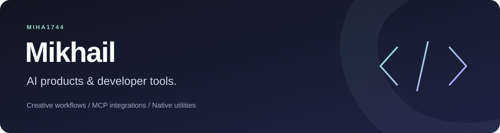

# Hi, I'm Mikhail

I work on AI tools for creative workflows, with a focus on MCP integrations.

## AI tools and integrations

**[OutSlide MCP](https://github.com/miha1744/outslide-mcp)** connects AI assistants with OutSlide's hosted creative workspace:

- Account-linked image generation, with model selection and credit quotes.
- A free public presentation-outline preview from a topic or inline CSV/JSON.

The repository contains setup instructions and discovery metadata. The hosted service is proprietary.

[Connect OutSlide MCP](https://outslide.ai/mcp) · [Read the documentation](https://github.com/miha1744/outslide-mcp#readme)

## Also building

**[QuietBar](https://github.com/miha1744/QuietBar)** is a native macOS menu bar utility written in Objective-C, with an indicator-group filter and an experimental application launcher.

**Preview software, ad hoc signed and unnotarized.** Targets macOS 14+ on Apple Silicon and Intel. A successful launch does not establish hidden indicators or working capture.

[Preview releases](https://github.com/miha1744/QuietBar/releases) · [Compatibility and evidence](https://github.com/miha1744/QuietBar/blob/main/docs/compatibility.md)

## Tools I work with

Python · Swift · Objective-C · Model Context Protocol
